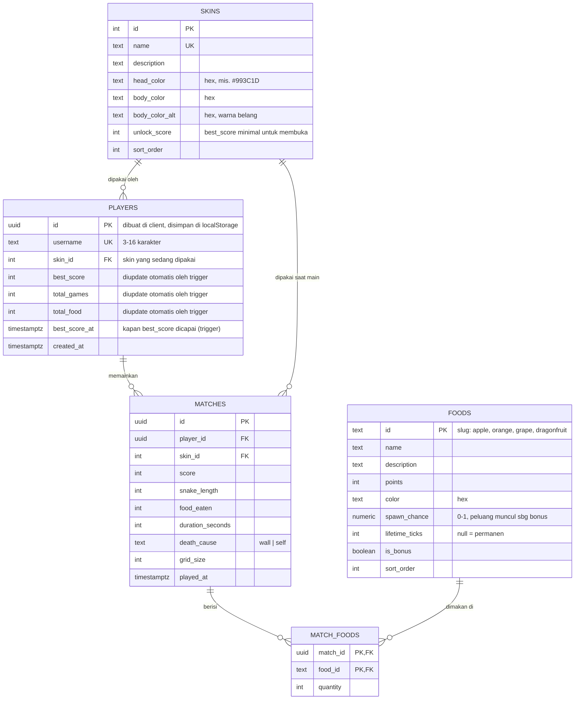

# ERD — Ularlarilurus

Acuan struktur data untuk API sendiri (`/api/*`, Vercel Functions) di atas database Neon Postgres.
Skema SQL lengkap ada di `db/schema.sql`.
Kalau ada perubahan struktur, ubah **dua-duanya**: file ini dan `schema.sql`.

## Diagram

## Penjelasan tabel

| Tabel | Isi | Dipakai di halaman |
|---|---|---|
| `players` | Satu baris per pemain (per perangkat). Tanpa login: `id` UUID dibuat di client saat pertama buka, disimpan di localStorage bersama username. | Leaderboard, Detail Pemain, Home |
| `skins` | Katalog skin ular. Terbuka kalau `players.best_score >= unlock_score`. Data master (diisi lewat seed). | Skin, Detail Skin, Game |
| `foods` | Jenis makanan dan poinnya. Data master. Game mengambil data ini (dengan fallback konstanta lokal). | Game, About (panduan makanan) |
| `matches` | Satu baris per permainan selesai (game over). Insert ke sini memicu trigger yang mengupdate statistik di `players`. | Riwayat, Detail Match, Detail Pemain |
| `match_foods` | Rincian makanan yang dimakan per match (relasi banyak-ke-banyak `matches` ↔ `foods`). | Detail Match |

## Relasi

- `players.skin_id` → `skins.id` (banyak pemain bisa memakai skin yang sama)
- `matches.player_id` → `players.id` (`ON DELETE CASCADE`)
- `matches.skin_id` → `skins.id` (skin yang dipakai saat match itu)
- `match_foods.match_id` → `matches.id` (`ON DELETE CASCADE`)
- `match_foods.food_id` → `foods.id`

## Aturan bisnis yang dijaga database

- **Leaderboard** = view `leaderboard`: pemain dengan `best_score > 0`, urut `best_score` turun lalu `best_score_at` naik (yang lebih dulu mencapai skor itu menang), dengan kolom `rank`.
- **Trigger `trg_matches_after_insert`**: setiap insert ke `matches` otomatis menaikkan `total_games` dan `total_food` serta mengganti `best_score` dan `best_score_at` kalau skor baru lebih tinggi. Client **tidak** mengupdate `best_score` sendiri.
- `username` unik tanpa membedakan huruf besar/kecil (index `lower(username)`).
- `score >= 0`, `death_cause in ('wall','self')`, `quantity > 0`.

## Endpoint REST (API sendiri, folder `api/`)

Base URL: `/api` (domain yang sama dengan aplikasi; bisa diganti lewat `VITE_API_BASE_URL`).
Tidak ada key di browser; endpoint mengakses Neon dengan `DATABASE_URL` di server.

Format respons: JSON langsung (objek atau array) dengan nama kolom snake_case sesuai tabel.
Error: status HTTP 4xx/5xx + body `{ "error": { "code": "...", "message": "..." } }`.

| Kebutuhan | Method & path | File | Keterangan |
|---|---|---|---|
| Cek API & database | `GET /api/health` | `api/health.js` | `{ ok, database, server_time, skins, foods }` |
| Daftar leaderboard | `GET /api/leaderboard?limit=50` | `api/leaderboard.js` | dari view `leaderboard` |
| Daftarkan pemain | `POST /api/players` body `{ id, username }` | `api/players/index.js` | 201 + data pemain; 409 kalau username dipakai |
| Cek username dipakai | `GET /api/players?username={name}` | `api/players/index.js` | `{ available: true/false }` (tanpa beda huruf besar/kecil) |
| Detail pemain | `GET /api/players/{id}` | `api/players/[id].js` | data pemain + objek `skin` |
| Ganti username / skin | `PATCH /api/players/{id}` body `{ username }` dan/atau `{ skin_id }` | `api/players/[id].js` | hanya 2 kolom ini; skin harus sudah terbuka (`unlock_score <= best_score`) |
| Match terakhir pemain / riwayat saya | `GET /api/matches?player_id={id}&limit=10` | `api/matches/index.js` | urut `played_at` turun |
| Simpan hasil main | `POST /api/matches` body `{ id, player_id, skin_id, score, snake_length, food_eaten, duration_seconds, death_cause, grid_size, played_at, foods: [{ food_id, quantity }] }` | `api/matches/index.js` | `matches` + `match_foods` dalam satu transaksi; idempoten (`on conflict (id) do nothing`) |
| Detail match | `GET /api/matches/{id}` | `api/matches/[id].js` | match + objek `skin` + array `foods` (`{ ...food, quantity }`) |
| Daftar skin | `GET /api/skins` | `api/skins/index.js` | urut `sort_order` |
| Detail skin | `GET /api/skins/{id}` | `api/skins/[id].js` | |
| Daftar makanan | `GET /api/foods` | `api/foods.js` | urut `sort_order`; `spawn_chance` dikirim sebagai number |
| Login admin | `POST /api/admin` body `{ password }` | `api/admin/index.js` | cek `ADMIN_PASSWORD`; balas `{ token, expires_at }` |
| Ringkasan & daftar akun (admin) | `GET /api/admin` (Bearer token) | `api/admin/index.js` | ringkasan global, pemakaian skin, daftar semua akun + peringkat terbaru |
| Detail akun (admin) | `GET /api/admin/players/{id}` (Bearer token) | `api/admin/players/[id].js` | profil, statistik lengkap, rincian makanan, 20 match terakhir |
| Hapus akun (admin) | `DELETE /api/admin/players/{id}` (Bearer token) | `api/admin/players/[id].js` | hapus pemain + semua match & rincian makanan (`on delete cascade`) |

`id` pemain dan match dibuat di client (`crypto.randomUUID()`). Karena `POST /api/matches` idempoten,
match yang disimpan offline bisa dikirim ulang tanpa duplikat.
